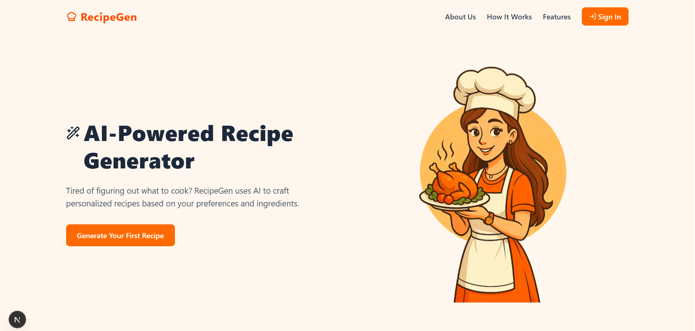
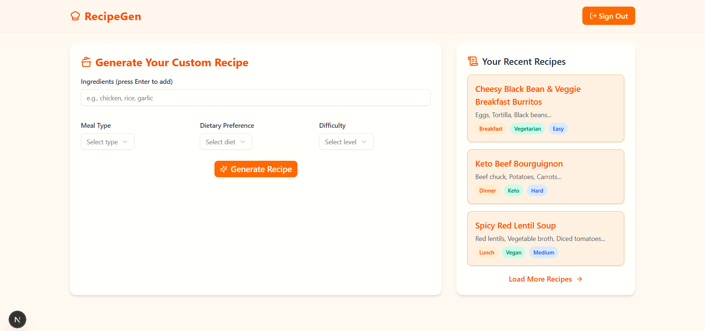
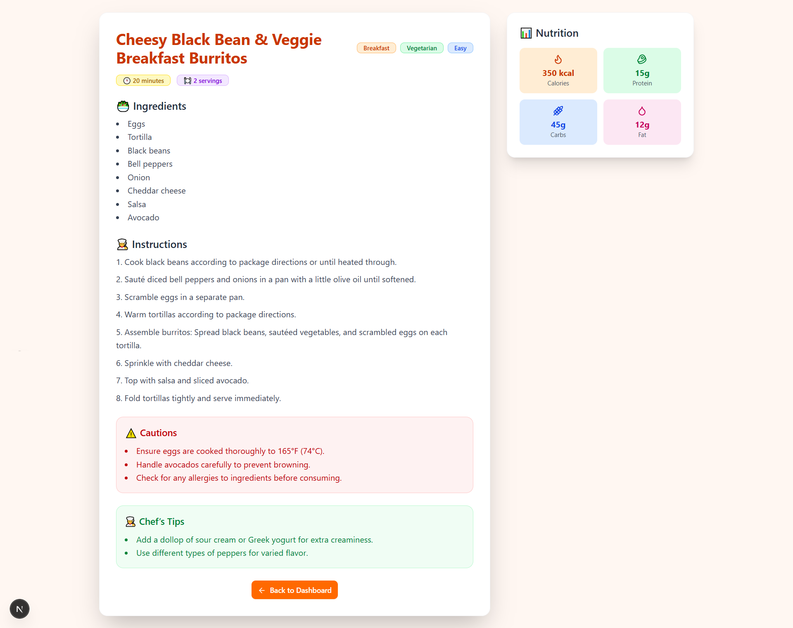

# 👨‍🍳 AI Recipe Generator

An **AI-powered web application** that generates **personalized recipes** based on user-provided ingredients, dietary preferences, and difficulty level.  
Built with **Next.js 15**, **Supabase**, **MongoDB**, and the **Gemini API**, this app delivers recipes with **nutritional breakdown, cooking tips, and cautions** – all in a clean, user-friendly UI.

---

## 🚀 Features

✅ **AI Recipe Generation** – Provide ingredients, diet type, and cooking difficulty → get a fully structured recipe.  
✅ **Nutritional Breakdown** – Calories, carbs, proteins, and fats displayed in styled cards.  
✅ **Chef’s Tips & Cautions** – Safety notes + pro cooking tips from our AI Chef.  
✅ **Authentication via Supabase** – Secure login with email/password.  
✅ **Recipe History** – Access previously generated recipes with a “Load More” option.  
✅ **Modern UI** – Clean **Landing Page**, Dashboard, Recipe Pages (designed with **Tailwind CSS** + **ShadCN UI**).  
✅ **Deployed with CI/CD** – Hosted on **Vercel** with auto-deployment on every push.

---

## 🏗️ Tech Stack

- **Frontend:** [Next.js 15](https://nextjs.org/), [Tailwind CSS 4](https://tailwindcss.com/), [ShadCN UI](https://ui.shadcn.com/)  
- **AI:** [Gemini API](https://aistudio.google.com/docs) (recipe generation with structured JSON output)  
- **Auth:** [Supabase](https://supabase.com/) (email/password)  
- **Database:** [MongoDB Atlas](https://www.mongodb.com/) (store user recipes)  
- **Deployment:** [Vercel](https://vercel.com/)

---

## ⚙️ **Setup Instructions**

### 1️⃣ **Clone the repo**
```bash
git clone https://github.com/your-username/AI-Recipe-Generator.git
cd AI-Recipe-Generator
```

### 2️⃣ Install dependencies
```bash
pnpm install
```

### 3️⃣ Environment variables
Create a .env.local file in the root:
```bash
NEXT_PUBLIC_SUPABASE_URL=your-supabase-url
NEXT_PUBLIC_SUPABASE_PUBLISHABLE_KEY=your-supabase-publishable-key
MONGODB_URI=your-mongodb-connection-string
GEMINI_API_KEY=your-gemini-api-key
GEMINI_MODEL=gemini-3.5-flash-lite
```

### 4️⃣ Run the app
``` bash
pnpm dev
```

---

## 🌍 **Deployment**

Deployed on Vercel. Every push to main triggers CI/CD build:
```bash
git add .
git commit -m "feat: add new recipe features"
git push origin main
```

---

## 📸 **Screenshots**
🖼 Landing Page


🖼 Dashboard Page


🖼 Recipe Detail Page


---

## 🌐 **Live Demo**

You can view the live version of the AI Recipe Generator App deployed on Vercel here:

https://nexium-bismah-ai-recipe-generator.vercel.app/

---

## 👩‍💻 **Author**
Bismah Nasir

🎓 Final Year BS Computer Science Student | 👩‍💻 Software Developer

---

## 📜 **License**
MIT License – feel free to use this project for learning or personal use.
